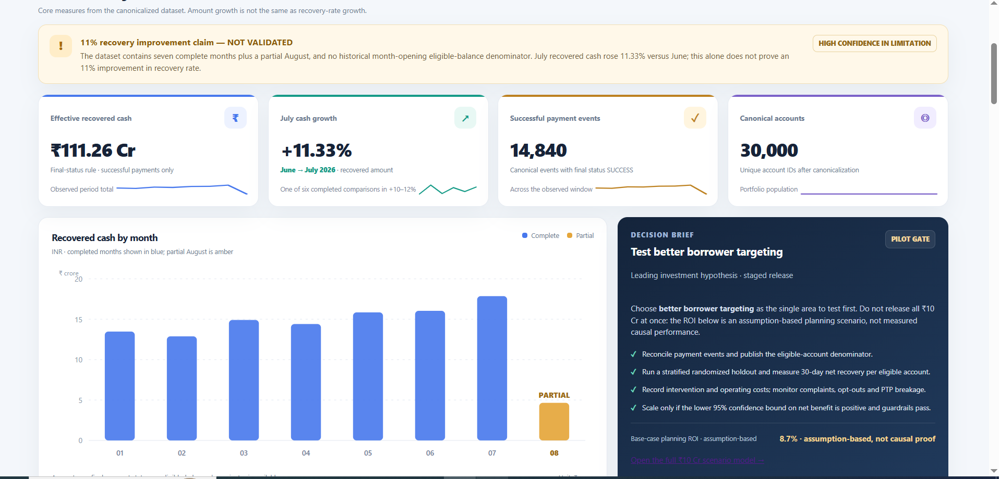
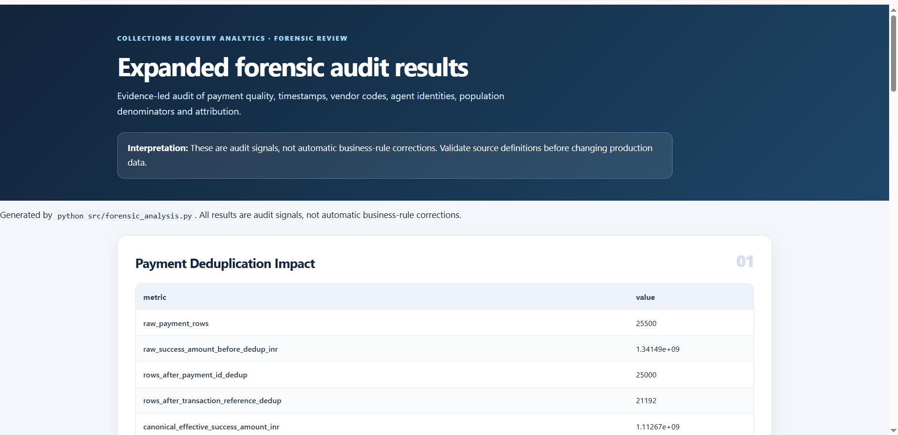
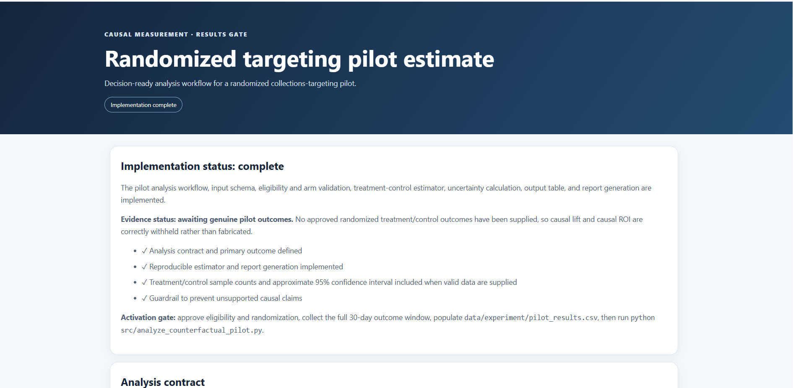
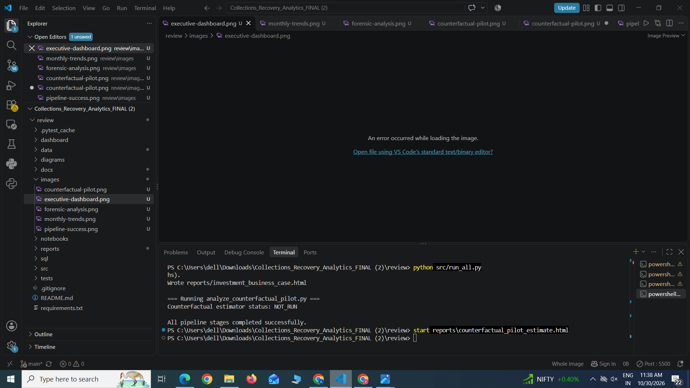
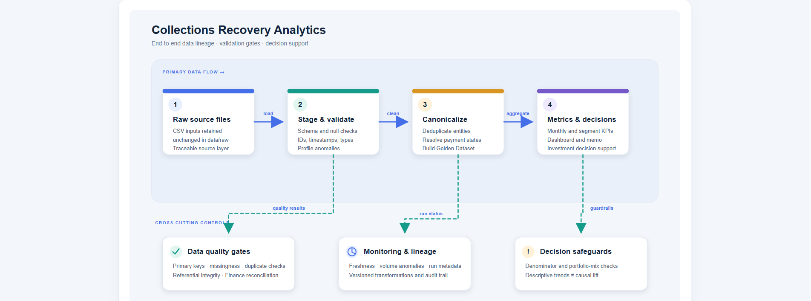

# 📊 Collections Recovery Analytics

### An End-to-End Data Analytics Platform for Payment Recovery, Financial Reconciliation & Business Intelligence

**Collections Recovery Analytics** is a data analytics project designed to transform collections and payment data into actionable business insights. It combines data cleaning, quality validation, SQL-based analysis, recovery performance monitoring, financial reconciliation, and counterfactual pilot evaluation to support data-driven collections strategies.

The platform demonstrates how data analytics can help financial operations teams understand payment behavior, monitor recovery performance, identify collection trends, and evaluate potential improvement strategies.

---

## 🚀 Project Overview

Collections teams need reliable data and meaningful performance indicators to understand how effectively outstanding payments are recovered.

This project provides a structured analytics workflow that processes transaction data, validates data quality, analyzes recovery trends, and presents business-focused reports to support operational decision-making.

### Key Objectives

- Analyze payment and collections recovery performance.
- Improve transaction data quality and consistency.
- Track recovery trends and key business metrics.
- Support financial reconciliation and reporting workflows.
- Evaluate collections pilot strategies using counterfactual analysis.
- Estimate potential financial impact and return on investment (ROI).
- Convert raw data into clear, decision-oriented insights.

---

## ✨ Key Features

### 1. Data Cleaning & Quality Assurance
- Transaction data validation and standardization.
- Data consistency and completeness checks.
- Identification of duplicate and invalid records.
- Structured data-quality reporting.
- Reliable data preparation for downstream analysis.

### 2. Collections Recovery Analytics
- Payment recovery trend analysis.
- Collections performance monitoring.
- Analysis of payment and transaction patterns.
- Business metric calculation and reporting.
- Insights to support collections strategy optimization.

### 3. Financial Reconciliation
- Structured reconciliation workflows for financial metrics.
- Comparison of transaction-level data and aggregated reporting values.
- Reconciliation logic to support consistent financial reporting.
- Reusable analysis workflows for financial data validation.

### 4. Counterfactual Pilot Evaluation
- A dedicated framework for evaluating collections improvement initiatives.
- Structured comparison of baseline performance and proposed pilot scenarios.
- Counterfactual estimation methodology to support impact evaluation.
- Analysis of potential incremental recovery outcomes.
- Business-oriented reporting to help stakeholders assess pilot opportunities.

### 5. ROI & Business Impact Modeling
- Financial impact estimation for proposed collections strategies.
- Scenario-based recovery analysis.
- Cost and benefit modeling to support investment decisions.
- ROI-oriented reporting for operational planning.

### 6. Automated Analytics Workflow
- Reusable Python-based analysis scripts.
- SQL-oriented analytical workflows.
- Organized reports for business interpretation.
- Reproducible processing and validation steps.
- Modular project structure for maintainability and future enhancement.

---

## 🛠️ Technology Stack

| Technology | Purpose |
|---|---|
| **Python** | Data processing, validation, analytics, and automation |
| **SQL** | Data querying, aggregation, and analytical workflows |
| **Jupyter Notebook** | Exploratory data analysis and interactive investigation |
| **Pandas** | Data manipulation and transformation |
| **HTML** | Business-facing analytical reports |
| **Git & GitHub** | Version control and project management |

---

## 🏗️ Project Workflow

```text
Raw Collections & Payment Data
              |
              v
      Data Ingestion
              |
              v
 Data Cleaning & Validation
              |
              v
    Data Quality Checks
              |
              v
     Analytical Processing
              |
       +------+------+
       |             |
       v             v
 Recovery Trends   Financial
 & KPI Analysis    Reconciliation
       |             |
       +------+------+
              |
              v
 Counterfactual Pilot Evaluation
              |
              v
    ROI & Scenario Modeling
              |
              v
    Reports & Business Insights
```

---

## 📈 Business Value

The project demonstrates how analytics can support collections and financial operations through:

- **Improved data reliability:** Structured validation helps maintain consistent analytical inputs.
- **Performance visibility:** Recovery trend analysis makes collections patterns easier to understand.
- **Better financial reporting:** Reconciliation workflows support metric consistency.
- **Evidence-based planning:** Counterfactual evaluation provides a structured way to assess proposed interventions.
- **Investment evaluation:** ROI modeling helps compare potential costs and benefits.
- **Operational efficiency:** Reusable analytical scripts reduce repetitive manual analysis.

---

## 📂 Project Structure

```text
Collections_Recovery_Analytics/
│
├── reports/
│   ├── counterfactual_pilot_estimate.html
│   └── ...
│
├── src/
│   ├── analyze_counterfactual_pilot.py
│   └── ...
│
├── notebooks/
│   └── ...
│
├── sql/
│   └── ...
│
├── data/
│   └── ...
│
├── tests/
│   └── ...
│
└── README.md
```

The project is organized into analytical scripts, reports, notebooks, SQL resources, data assets, and validation tests. File availability may vary by project version.

---

## ⚙️ Getting Started

### Prerequisites

- Python 3.10 or later
- Git
- Visual Studio Code or another Python-compatible editor
- Jupyter Notebook, if you want to explore notebook-based analysis

### 1. Clone the repository

```bash
git clone https://github.com/adepukaashyap/collections-recovery-analytics.git
cd collections-recovery-analytics
```

### 2. Create a virtual environment

**Windows:**

```powershell
python -m venv .venv
.venv\Scripts\activate
```

**macOS/Linux:**

```bash
python3 -m venv .venv
source .venv/bin/activate
```

### 3. Install dependencies

If the repository includes a `requirements.txt` file, run:

```bash
pip install -r requirements.txt
```

For notebook-based analysis, install Jupyter if needed:

```bash
pip install notebook
```

### 4. Explore the project

- Review the `reports/` directory for analytical outputs.
- Explore `src/` for Python analysis scripts.
- Review the notebooks for exploratory analysis.
- Explore the SQL resources for analytical queries and reconciliation logic.
- Run the available validation tests using the project's documented test instructions.

---

## 🧪 Quality & Validation

The project incorporates automated validation practices to support analytical reliability, including:

- Data-quality checks.
- Analytical logic tests.
- Financial metric consistency checks.
- Reconciliation-oriented validation.
- Reproducible processing workflows.

---

## 🎯 Skills Demonstrated

This project showcases practical skills relevant to Data Analyst, Business Analyst, Financial Data Analyst, and Analytics Engineer roles:

- Exploratory Data Analysis (EDA)
- Python for Data Analytics
- SQL and data aggregation
- Data cleaning and preprocessing
- Data quality assurance
- Financial data analysis
- Collections and payment performance analysis
- Counterfactual evaluation methodology
- ROI and scenario modeling
- Analytical reporting
- Testing and reproducibility
- Git and GitHub

---

## 🔮 Future Enhancements

- Interactive collections performance dashboard.
- Advanced recovery forecasting.
- Integration with live financial data sources.
- Expanded KPI monitoring and alerting.
- Enhanced scenario analysis and pilot outcome tracking.
- Scheduled report generation and analytics automation.

---

## 👨‍💻 Author

**Adepu Kaashyap**

GitHub: [@adepukaashyap](https://github.com/adepukaashyap)

---

## ⭐ Project

If you find this project useful, consider starring the repository on GitHub.

**Repository:** [Collections Recovery Analytics](https://github.com/adepukaashyap/collections-recovery-analytics)

*Turning collections data into structured analysis, financial insights, and data-driven decisions.*


## 📸 Project Screenshots

### 1. Executive Dashboard


### 2. Monthly Trends and Portfolio Analysis


### 3. Data Forensics


### 4. Counterfactual Pilot Estimate


### 5. Pipeline Execution


### 6. System Architecture

